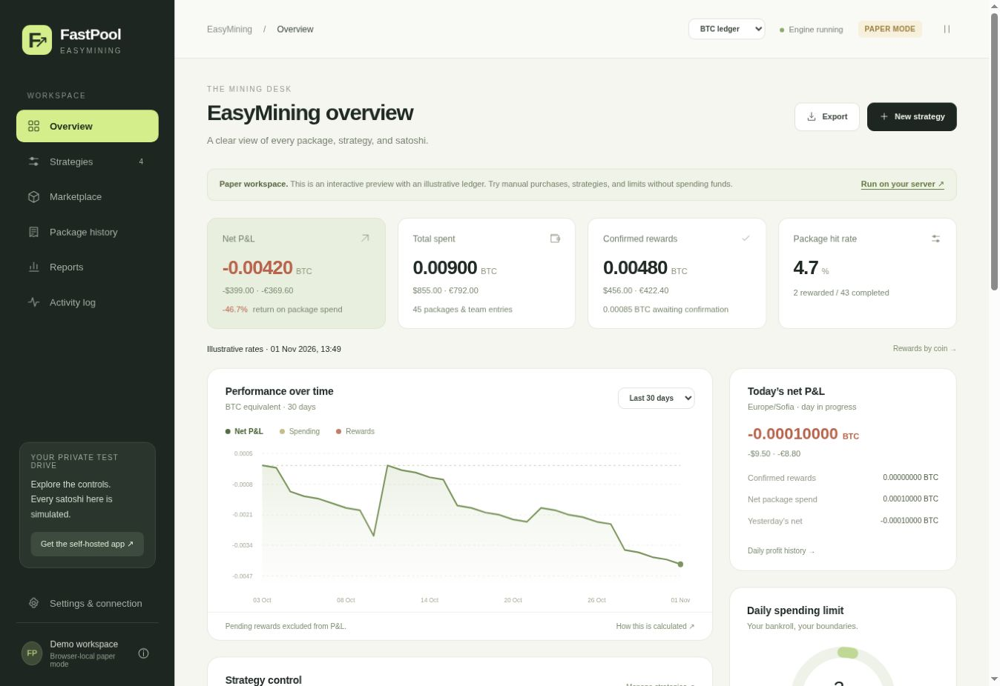
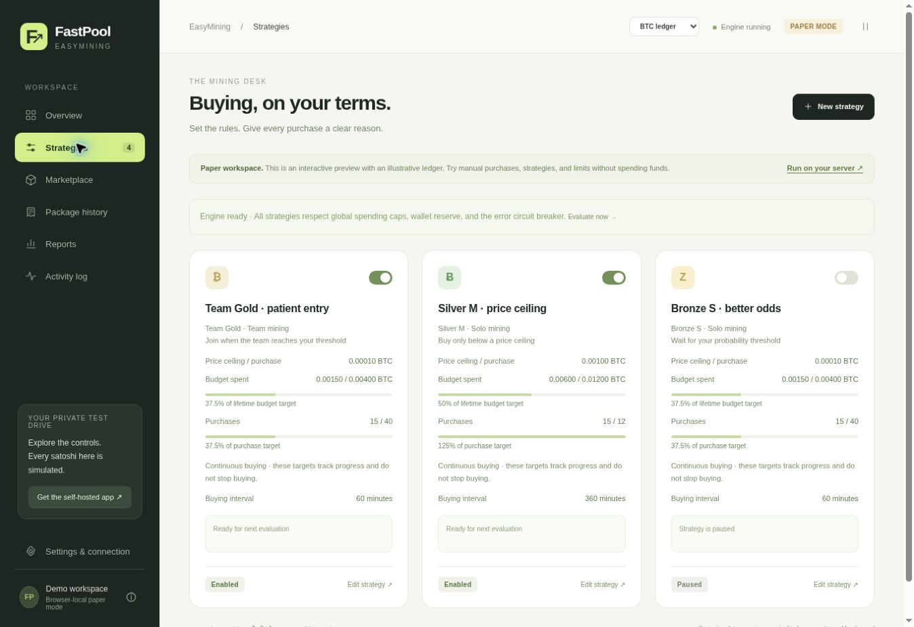
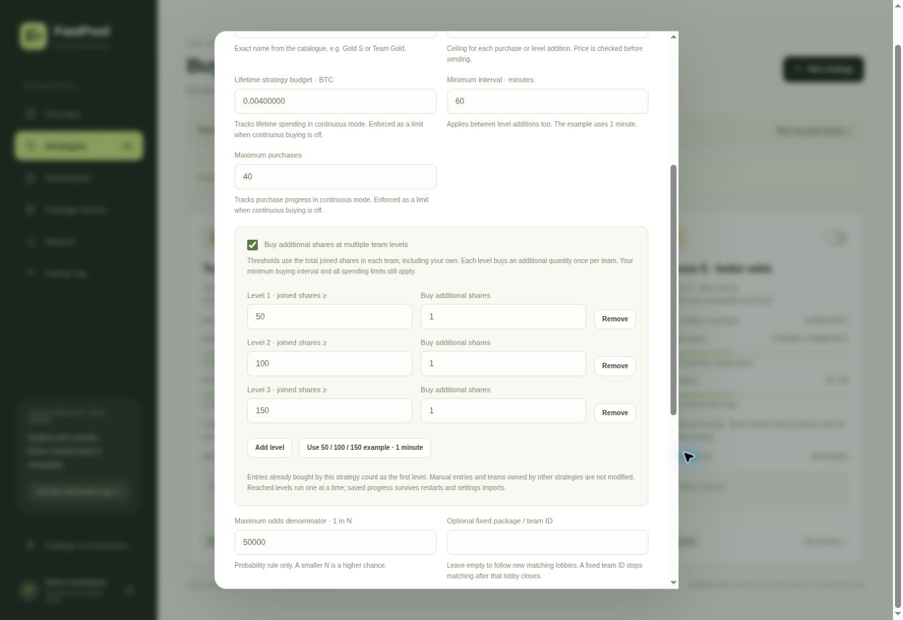
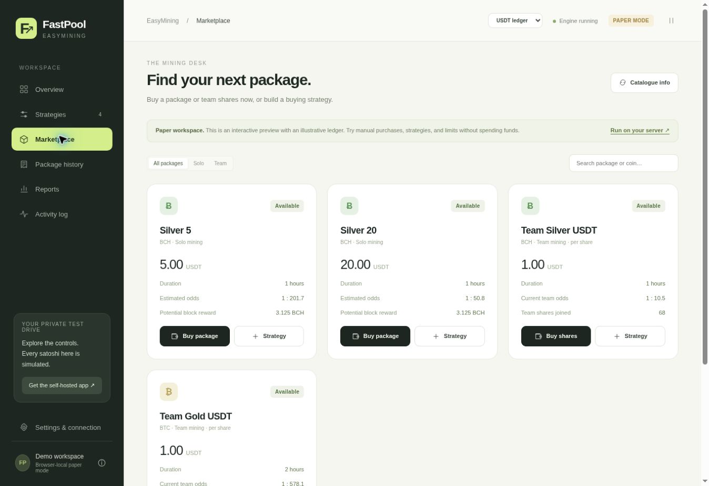
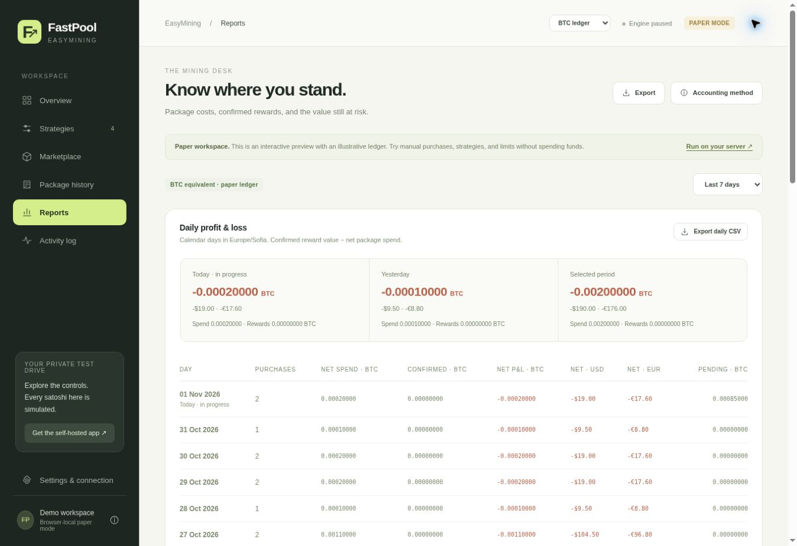
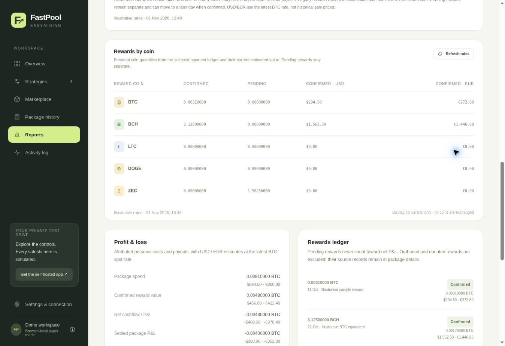
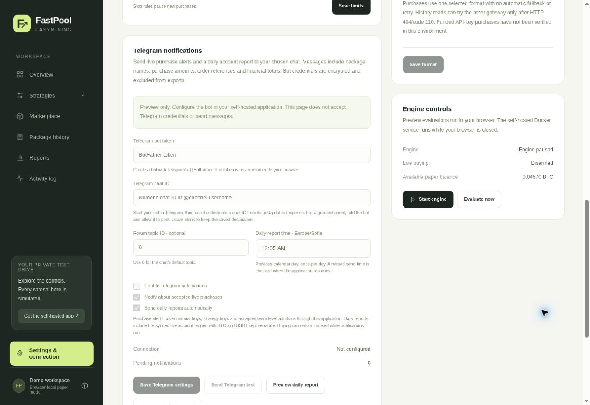

# FastPool EasyMining

**A self-hosted NiceHash EasyMining controller with a Go backend and a browser dashboard.**

Buy solo packages or team shares, automate buying strategies, and track personal rewards and profit & loss across separate BTC and USDT ledgers. Manage connections, payout destinations, spending limits, reports, and notifications from the web UI.

**Current version:** `2.2.5-go` · **Runtime:** Go + SQLite · **Deployment:** Docker or standalone executables

[](https://github.com/SolFly/FastPool-EasyMining/actions/workflows/ci.yml) · [Download the latest release](https://github.com/SolFly/FastPool-EasyMining/releases/latest) · [MIT license](LICENSE)



*All screenshots show the paper demo with illustrative data. The self-hosted Go server connects to your NiceHash account; the browser demo uses simulated funds.*

[Quick start](#quick-start) · [Screenshots](#screenshots) · [Configuration](#configuration) · [Strategies](#strategies) · [Reports](#reports-and-accounting) · [Upgrading](#upgrading) · [Troubleshooting](#troubleshooting) · [Changelog](CHANGELOG.md)

## Features

| Area | What you can do |
| --- | --- |
| Package buying | Review and buy solo packages or team shares directly from the marketplace. |
| Strategies | Use buying intervals, price ceilings, probability thresholds, team participation levels, and local buying windows. |
| Multi-level teams | Buy additional shares once per configured threshold, such as 1 at 50 joined shares, another at 100, and another at 150. |
| Continuous buying | Keep a strategy buying until paused, with editable budget and purchase progress targets. Optional limited mode enforces lifetime targets. |
| BTC & USDT | Keep payment balances, limits, spending, and P&L separate for each market. |
| Payout destinations | Choose saved NiceHash primary and merged reward addresses, where available. |
| Spending controls | Set daily, weekly, and monthly caps, maximum purchase amounts, wallet reserves, concurrency, and stop rules. |
| Rewards & reports | See personal BTC, BCH, LTC, DOGE, and ZEC quantities, pending rewards, daily P&L, and current USD/EUR estimates. |
| Telegram | Receive accepted live purchase alerts and a scheduled daily account report. |
| Configuration | Export and import settings and strategies with a review before applying changes. |
| Diagnostics | Inspect strategy decisions, account sync progress, purchase traces, and sanitized diagnostic exports. |

The Go application runs on your server while the browser is closed. Its executable embeds the web UI; Node.js is only used for optional development tools and regression tests.

## Screenshots

Click an image to view it at full size. Every view below uses the same paper demo; values are examples, not investment returns.

| Strategy progress | Multi-level team buying |
| --- | --- |
|  |  |

| USDT marketplace | Daily profit & loss |
| --- | --- |
|  |  |

| Rewards by coin | Telegram settings |
| --- | --- |
|  |  |

## Quick start

### Docker Compose

Download or clone the repository, then run these commands **from its root directory**:

```sh
cp .env.example .env
docker compose up -d --build
docker compose logs easymining
```

Open **http://localhost:8080**. On a new installation, use the one-time setup token printed in the logs to create an administrator password of at least 12 characters. An optional `APP_PASSWORD` can instead initialize the password on first setup.

The repository's Compose configuration publishes port 8080 on the host. To use an SSH tunnel or a local HTTPS reverse proxy, change the port mapping to `127.0.0.1:8080:8080`. Set `PUBLIC_URL` to the exact browser origin when using a proxy.

```sh
# Run on your own computer; replace user@your-server with your SSH destination.
ssh -L 8080:127.0.0.1:8080 user@your-server
```

The Docker build includes vendored Go dependencies, compiles SQLite, and runs the service as UID 1000. It needs access to Docker base images and Alpine package repositories during the build. Persistent state is stored in the `easymining_data` named volume at `/data`.

### Standalone Windows, macOS and Linux binaries

Download your system's portable ZIP from [Releases](https://github.com/SolFly/FastPool-EasyMining/releases/latest). Each ZIP contains an executable with the browser UI embedded, a start guide, example configuration, and the license.

| Computer / operating system | Target in the filename |
| --- | --- |
| Windows x64 (Intel/AMD) | `windows-amd64` |
| Windows ARM64 | `windows-arm64` |
| macOS Intel | `darwin-amd64` |
| macOS Apple Silicon (M-series) | `darwin-arm64` |
| Linux x64 (Intel/AMD) | `linux-amd64` |
| Linux ARM64 (including 64-bit Raspberry Pi OS) | `linux-arm64` |

Extract the ZIP and open PowerShell or a terminal in the extracted folder. Windows example:

```powershell
Copy-Item .env.example .env
.\fastpool-easymining-windows-amd64.exe --env-file=.env
```

macOS Apple Silicon example (use your target's filename on another system):

```sh
cp .env.example .env
chmod +x fastpool-easymining-darwin-arm64
./fastpool-easymining-darwin-arm64 --env-file=.env
```

Open **http://localhost:8080** and use the setup token printed in the terminal. Keep the process running while buying or syncing. The binaries need no Node.js runtime or separately installed SQLite server. Linux binaries are static; Windows binaries need no compiler installation; macOS uses built-in system libraries. Windows/macOS executables are unsigned, and macOS builds are not notarized, so the operating system may request approval.

The native test runners are Ubuntu 24.04 (x64/ARM64), Windows Server 2025 x64, Windows 11 ARM64, and macOS 15 (Intel/Apple Silicon). Older operating systems and 32-bit targets are not covered by the prebuilt release checks.

Run from your installation folder so `./data` and `config.json` refer to the intended files. When upgrading, keep the existing data directory and its matching `master.key`. Without `--env-file`, set variables through your service manager. Verify downloaded files with `SHA256SUMS`; `BUILD_INFO.json` identifies the commit and native test results for all six targets.

The full Linux amd64 distribution also retains `bin/fastpool-easymining-linux-amd64` and the Docker/Go source layout used by earlier releases.

## Configuration

Most settings are available under **Settings & connection**. NiceHash credentials can come from the UI, environment variables, or a JSON configuration file. The UI displays which source is active.

| Variable | Purpose / default |
| --- | --- |
| `HOST` | Listener address; standalone default `127.0.0.1`, Docker `0.0.0.0` inside the container. |
| `PORT` | HTTP port; `8080`. |
| `DATA_DIR` | Persistent state directory; standalone `./data`, Docker `/data`. |
| `PUBLIC_URL` | Exact external browser origin for an HTTPS reverse proxy. |
| `APP_PASSWORD` | Optional initial administrator password, at least 12 characters. |
| `NICEHASH_API_KEY` | NiceHash API key. |
| `NICEHASH_API_SECRET` | NiceHash API secret. |
| `NICEHASH_ORGANIZATION_ID` | Organization ID associated with the key and account. |
| `NICEHASH_BASE_URL` | API base URL; `https://api2.nicehash.com`. |
| `NICEHASH_CONFIG_FILE` | Optional path to the JSON connection configuration. |

For JSON configuration, copy [config.example.json](config.example.json) to `config.json`, or set `NICEHASH_CONFIG_FILE` to its path:

```json
{
  "nicehash": {
    "api_key": "${NICEHASH_API_KEY}",
    "api_secret": "${NICEHASH_API_SECRET}",
    "organization_id": "${NICEHASH_ORGANIZATION_ID}",
    "base_url": "https://api2.nicehash.com"
  }
}
```

Set those placeholder variables in the server environment. For Docker, mount a custom JSON file read-only and pass its container path. Use the permissions needed for balance/history reads and EasyMining purchases; withdrawals are not required. UI-saved credentials are encrypted on disk and excluded from exports.

### First run and live buying

1. Start in **Paper** mode and review the marketplace, strategy rules, and reports.
2. Configure the NiceHash connection and use **Test & sync**. Review any history or spending verification issues.
3. Set spending caps, reserve, and maximum purchase amounts for each payment market you intend to use. USDT limits require configuration before buying.
4. Create and enable strategies, or use **Buy package / Buy shares** in the marketplace for a manual purchase review.
5. For live automation, select **Live**, complete **Enable real purchases → Arm live buying**, then explicitly **Start engine**.

Arming leaves the engine paused. Every server restart also pauses and disarms buying. Settings imports do not arm or start the engine.

The **BTC ledger / USDT ledger** selector changes the displayed market. Engine mode, arming, start/pause, and concurrency are shared: a running engine evaluates enabled strategies in both markets.

## Strategies

Strategies can follow a package name and coin, or target a fixed package/team ID. Leave the fixed ID empty to follow new matching teams after the current lobby closes. Each strategy spends one payment currency and has its own buying interval and optional local schedule.

### Multi-level team buying

Enable **Buy additional shares at multiple team levels** in a team strategy:

| Total joined team shares | Additional shares to buy | Your cumulative shares after this level |
| --- | --- | --- |
| 50 | 1 | 1 |
| 100 | 1 | 2 |
| 150 | 1 | 3 |

Thresholds use the team's total joined shares, including your own. Each level runs once per team; reached levels run one at a time and still respect the minimum buying interval and spending controls. Saved progress survives restarts and configuration imports. Later additions require verified personal membership and spending details.

### Continuous and limited buying

**Keep buying until I pause this strategy** is continuous mode. A reward or a reached lifetime budget/purchase target does not stop it. Budget and purchase fields remain editable and their progress stays visible. Turn continuous mode off to enforce those lifetime limits and optionally stop after a confirmed reward.

Global daily/weekly/monthly caps, maximum purchase amount, reserve, schedules, active-package limits, stop loss/take profit, and unresolved spending checks apply in both modes. A price ceiling is checked before submission; NiceHash's purchase endpoint does not provide an exchange-style limit order.

### Reward payout addresses

Choose saved NiceHash addresses when returned by the account API, including separate primary and merged reward destinations. A blank destination uses NiceHash's default/claim behavior. Background strategies use saved destinations or defaults. An unsaved address requires a manual purchase with current NiceHash 2FA; the app does not store the 2FA code.

## Reports and accounting

Reports use attributed **personal** costs and rewards. Team participation is accounted for by your contribution and member reward; whole-team block rewards and superseded duplicate execution records are excluded from personal totals.

- **Net P&L:** confirmed reward accounting value minus net package spend, including recorded fees, refunds, and unresolved reservations.
- **Daily P&L:** the same ledger grouped by local calendar day in the configured timezone, including daylight saving changes. Later additions and refunds use their recorded dates.
- **Confirmation dates:** rewards count when confirmation was first recorded. Older imported rewards may therefore appear on their import date.
- **Pending and unpriced rewards:** shown separately and excluded from confirmed P&L.
- **Coin quantities:** BTC, BCH, LTC, DOGE, and ZEC remain in their original coins. The coin table values those quantities at current spot rates.
- **USD/EUR estimates:** display conversions only. They use current available rates, not historical sale proceeds, and never exchange coins. Their value can differ from translating a previously recorded BTC/USDT accounting value.

BTC and USDT have separate ledgers. USDT reward accounting uses the available NiceHash BTC/USDT rate when valued and retains confirmed values. Missing rates leave rewards unpriced; USDT is not assumed to equal USD. Incomplete account history is flagged in reports.

Use **Reports → Export daily CSV** for daily totals, or **Export** for ledger data.

## Telegram notifications

Open **Settings & connection → Telegram notifications** in the self-hosted application:

1. Create a bot using Telegram's **@BotFather**, then message your bot.
2. Enter the bot token and destination chat ID from its `getUpdates` response. For a group/channel, add the bot and allow it to post; a forum topic ID is optional.
3. Save the connection, send a test, and enable purchase alerts and/or daily reports.
4. Choose the daily report time; the default is **00:05 in the application timezone**. It covers the previous local calendar day.

Purchase alerts cover accepted live manual buys, strategy buys, and team additions through this app. Imported website purchases appear in daily reports without replaying purchase alerts. Reports keep BTC and USDT separate and include net spending, confirmed values, P&L, pending values, and personal coin quantities.

**Preview daily report** sends nothing. The notification worker runs while buying is paused; keep the server running for scheduled delivery. Bot credentials are encrypted and excluded from exports. The paper demo accepts no Telegram credentials and sends no messages.

## Backups and settings imports

| Backup | What it restores |
| --- | --- |
| **Export settings** | Settings and strategies, reviewed before importing with merge or replace. |
| **Export JSON + ledger** | Configuration plus a ledger export for reference; importing restores its configuration only. |
| **Persistent data backup** | The actual SQLite ledger, administrator state, and encrypted connections, with the matching `master.key`. |

Configuration imports preserve existing ledger history, validate changes atomically, and import strategies paused. Telegram credentials/settings are instance-local and are not transferred by configuration import/export.

For a full restore, back up the **entire data directory/volume while the service is stopped**, including `controller.sqlite`, any SQLite journal files, and its matching `master.key`. Keep `.env` and custom deployment/configuration files with your private backups. The key is required to decrypt saved connections. Never commit these files to a public repository.

## Upgrading

Use your **existing installation directory and Compose project/volume identity**:

1. Stop the service with `docker compose stop`.
2. Replace application source with the new release. Preserve `.env`, custom Compose settings, and the existing data volume.
3. Rebuild and recreate the service:

   ```sh
   docker compose up -d --build --force-recreate easymining
   docker compose exec -T easymining easymining --version
   docker compose exec -T easymining wget -qO- http://127.0.0.1:8080/healthz
   ```

4. Confirm `2.2.5-go`, reload the UI, sign in, sync the account, then explicitly arm and start live buying when ready.

Do not use `docker compose down -v` for an upgrade: it removes the persistent volume. Changing the project directory can select a different volume. Existing installations under `GO-version` should retain that directory/project or explicitly map the original volume.

The first Go migration saves a `before-go-<timestamp>.sqlite` recovery snapshot in the data directory. Existing strategies, orders, cooldowns, rewards, spending journals, and encrypted connections are retained. Run one buyer against a ledger at a time. An interrupted submission keeps its reservation until spending can be verified.

## Troubleshooting

| Symptom | What to check |
| --- | --- |
| Browser and server versions differ | Check the actual image/binary with `--version` and `/healthz`, rebuild the original Compose service, recreate it, then reload the browser. |
| Balance verified but history incomplete | Read the displayed sync phase/warning and **Purchase sync details**. Use **Retry account sync** and download purchase diagnostics if it persists. |
| A purchase needs spending verification | Inspect the affected current order and its sync details. An unknown outcome retains its reservation until provider ownership/debit is verified. |
| Strategy waits at a team level | Check total joined shares, saved level progress, interval, schedule, and whether a fixed team ID has closed. |
| Team purchase returns 404 / code 110 | Check the selected request format and diagnostic route. A rejected target is excluded; the public listing alone does not prove it is purchasable. |
| Team purchase returns 400 / code 5251 | NiceHash rejected that team's state. That team is excluded while other eligible teams can continue. |
| Lifetime budget/count reached | In continuous mode these are progress targets. Turn continuous mode off if they should stop the strategy. |
| New USDT strategy does not buy | Configure USDT caps, maximum purchase amount, and reserve in the USDT ledger's settings. |

**Purchase API format** offers Documented (`/main`), Web client (`/hashpower`), and Guide (shares only). Documented is the default. Documented/Web support verified cumulative additions; Guide supports first joins only. Keep a working format selected. Saving a format pauses and disarms the engine. Purchase requests use that selected format without automatic POST fallback or replay; private history GETs have a separate limited read fallback.

For investigation, use **Activity log → Purchase debug mode**, **Download purchase diagnostics**, or **Run API audit**. Debug capture is off by default and expires automatically. Exports omit credentials, signatures, organization ID values, payout addresses, 2FA, and wallet balances, but include order/request references; review them before posting publicly. See [API-AUDIT.md](API-AUDIT.md) for the dated response investigation and [CHANGELOG.md](CHANGELOG.md) for recovery fixes.

<details>
<summary>Docker installations without working Buildx</summary>

Run in the original installation directory after replacing source, with the existing container still available for image lookup:

```sh
fastpool_image="$(docker inspect fastpool-easymining --format '{{.Config.Image}}')"
DOCKER_BUILDKIT=0 docker build --no-cache -f Dockerfile -t "$fastpool_image" .
docker run --rm --network none --entrypoint /usr/local/bin/easymining "$fastpool_image" --version
```

After it prints `FastPool EasyMining 2.2.5-go · Go`, recreate the service and check its health:

```sh
docker compose up -d --no-build --pull never --force-recreate easymining
docker compose exec -T easymining wget -qO- http://127.0.0.1:8080/healthz
```

</details>

## Development

### GitHub Actions and releases

- **CI** runs on pushes to `main`, pull requests, or **Actions → CI → Run workflow**. It runs Go vet/race tests and JavaScript regressions, builds the Docker image, checks the static executable's version, starts an isolated temporary instance, and saves the release files as a workflow artifact for 14 days.
- **Release** runs for `v*` tags, relevant version/release-note changes on `main`, or **Actions → Release → Run workflow**. It runs the same checks plus the **Native platforms** workflow, then publishes only after all six targets pass. Downloads include each native executable/portable ZIP, the full Linux amd64 distribution, source ZIP, combined build metadata and SHA-256 checksums. Existing published releases are left unchanged.
- For a new version, update `internal/controller/value.go`, `public/core.mjs`, and `package.json` together, and add `docs/releases/v<VERSION>.md`. Push to `main` or tag the matching commit, for example `v2.2.5-go`. Tag, UI, package, and server versions must agree.

Workflows use the repository's built-in `GITHUB_TOKEN`; no NiceHash or Telegram credentials are required. The native matrix runs Go unit tests, validates OS/CPU headers, and starts each executable twice with a temporary SQLite ledger to verify persistence. Only the release publication job requests `contents: write`. Pull requests run with read-only repository permissions. Third-party actions are pinned to full commit SHAs.

### Build and test locally

Build requirements: **Go 1.26+ and a C compiler**. SQLite is compiled from vendored source; a separate SQLite server is not required. The Dockerfile pins its Go toolchain. Third-party dependency licenses are retained under `vendor/`.

```sh
CGO_ENABLED=1 go build -mod=vendor -buildvcs=false \
  -tags 'netgo osusergo sqlite_omit_load_extension' \
  -trimpath -o easymining ./cmd/easymining
./easymining --env-file=.env
```

Run backend checks and optional JavaScript regression tests:

```sh
go test -mod=vendor ./...
go test -mod=vendor -race ./...
node --test tests/*.test.mjs
```

Tests use controlled provider responses and synthetic credentials/ledgers. They cover signing, authentication, migration, purchase reservations, team levels, exact amounts, personal rewards, accounting, history recovery, and notifications. They do not constitute a funded-account purchase test.

| Path | Contents |
| --- | --- |
| `cmd/easymining/` | Go server entry point. |
| `internal/controller/` | NiceHash adapter, buying engine, ledger, sync, notifications, and Go tests. |
| `public/` | Embedded browser UI and browser-side accounting modules. |
| `vendor/` | Pinned Go dependency source and dependency licenses. |
| `tests/`, `server/` | JavaScript regression tests, historical Node parity source, and fixtures. Production runs Go. |
| `docs/screenshots/` | Paper demo screenshots used by this README. |
| `scripts/` | Development preview, fixtures, and distribution/source packaging tools. |

`node scripts/source-zip.mjs` creates a GitHub source ZIP under `dist/downloads/`. It includes the Go source, vendored dependencies, tests, documentation, and screenshots. The binary release is packaged separately by `python3 scripts/package-go.py` after placing a built executable at `bin/fastpool-easymining-linux-amd64`. `node scripts/build.mjs` also prepares the static paper demo and packages that binary release; Node.js is not a production dependency.
